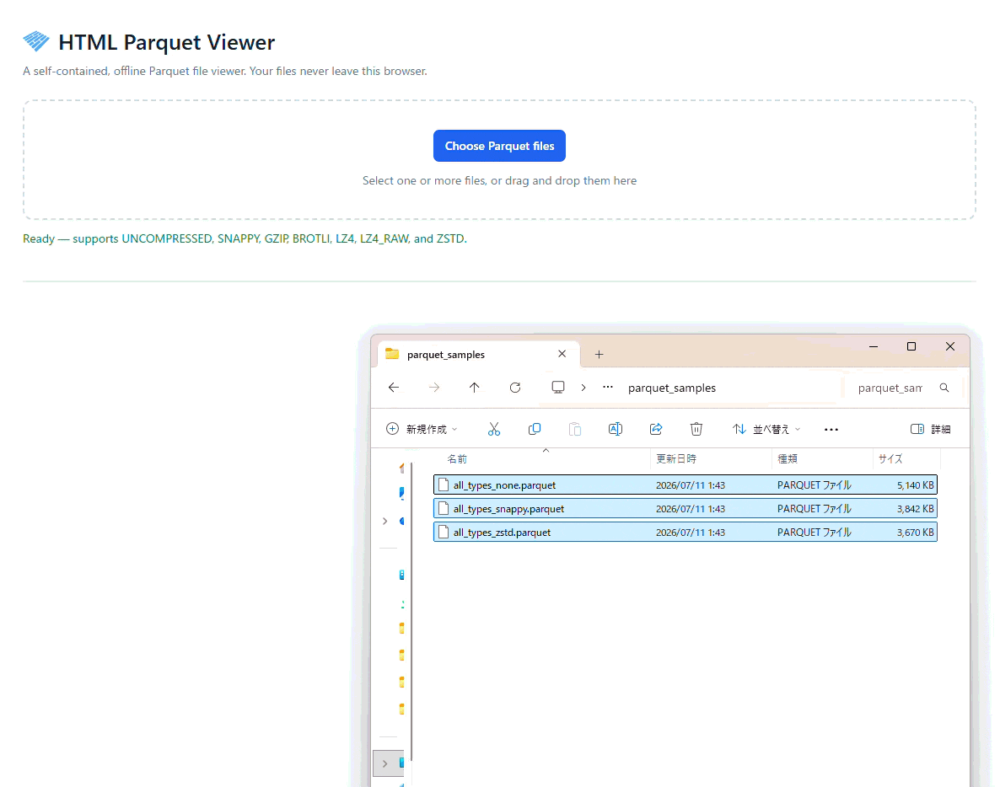

# HTML Parquet Viewer

A self-contained, offline Parquet file viewer delivered as **one HTML file**.

Open the file in a modern browser, select or drop Parquet files, and inspect them locally. No installation, build step, server, CDN, or network connection is required.

## Try it online

Open the hosted viewer:  
[parquet-viewer.html](https://ttomohisa.github.io/html-parquet-viewer/parquet-viewer.html)

Your files stay in your browser. Nothing is uploaded.

## Why

Parquet files often need a quick inspection on locked-down workstations, air-gapped networks, or during data-pipeline debugging. This viewer is designed for that job:

- **Single-file distribution** — copy one HTML file anywhere
- **Offline and private** — files stay in your browser, with network connections blocked by Content Security Policy
- **Metadata-first preview** — reads the footer and only the requested preview range; it does not eagerly expand the whole file into memory
- **No dependencies at runtime** — scripts, styles, and required codecs are embedded

## Features

- Switch between **Japanese and English** using the minimal JA / EN header button without closing a file or resetting the current page; the viewer starts in the saved language, or follows the browser language (Japanese browsers use Japanese, others use English)
- Open one or many local Parquet files from the picker or with drag and drop
- Work with several files at once in closable tabs
- Read Parquet v1 and v2 files
- Support uncompressed, Snappy, Gzip, Brotli, LZ4, LZ4_RAW, and Zstandard data
- Inspect file metadata (`created_by` and custom key/value metadata), schema, row count, row groups, and codecs
- Browse preview rows without loading the entire file
- Choose 50, 100, 250, 500, or 1,000 rows per page
- Jump directly to a page and see `Page N of M`
- Collapse the Schema and Data preview panels
- Display concise type badges such as `text`, `int64`, `time`, and `decimal`
- Distinguish `null` from an empty string without adding noise to empty cells
- Sort the current preview page: ascending → descending → reset, with exact signed BigInt ordering
- Find literal values on the current page with matching-row highlights, counts, and previous/next navigation
- Download or copy the current page as CSV
- Explain common read errors in actionable language

## Quick start

1. Download [`parquet-viewer.html`](./parquet-viewer.html) from this repository.
2. Open it in a current Chromium-based browser, Firefox, or Safari.
3. Use the small **JA / EN** button in the header to switch between Japanese and English.
4. Choose one or more `.parquet` files, or drag them into the drop area.

There is no upload. Your selected files remain local to your browser session.

## Preview behavior

The viewer is intentionally a **preview and inspection** tool, not a full query engine.

- Paging reads the current range of rows from the local file.
- Sorting and finding are explicitly limited to the current preview page. Finding never filters rows or reads another page.
- Find is case-insensitive and searches displayed cell text, including the `null` marker. Empty cells remain empty. Unannotated binary columns are preserved as bytes and shown as a byte-length/hex summary (up to the first 24 bytes); finding and CSV export use that summary, not the full hidden byte sequence.
- Each tab keeps its find query in memory. Page and sort changes reset the current match; loading or failed reads clear old results.
- Files whose metadata cannot be read retain their own error tab, which can be closed.
- Each tab retains its own completed preview and sort order. Switching back does not re-read a completed page.
- CSV actions are disabled while a page is loading or after a read failure. Retry by entering the page number again or choosing a smaller page size.
- The `Download CSV` and `Copy CSV` actions use the visible page, including its current sort order.
- Opening a new tab does not upload or persist a file; closing/reloading the browser removes the in-memory session.

## UI notes

| Interaction | Behavior |
|---|---|
| Click a column header, or focus its button and press Enter / Space | Ascending sort for the current page |
| Click it again | Descending sort |
| Click it a third time | Reset to the original read order |
| Tab to **Choose Parquet files** or a file's named close button, then press Enter / Space | Open the file picker or close that file |
| Click **Schema**, **File metadata**, or **Data preview** | Collapse or expand that section |
| Click **Download CSV** | Download the current preview page as a UTF-8 CSV file |
| Click **Copy CSV** | Copy the current preview page to the clipboard (with a local-file fallback) |
| Enter a page number | Jump to that page |
| Type in **Find values on this page** | Highlight matching rows without changing CSV contents or order |
| Press Enter / Shift+Enter in Find | Move to the next / previous matching row, wrapping within this page |
| Press Escape in Find or click **Clear** | Remove the query and highlights |

## Supported formats

| Item | Support |
|---|---|
| Parquet format | v1 and v2 |
| Compression | Uncompressed, Snappy, Gzip, Brotli, LZ4, LZ4_RAW, Zstandard |
| Files | Local files selected via browser picker or drag and drop |
| Network | Not required; the viewer is designed to run offline |

Support ultimately depends on the encodings used by the file and the embedded parser/codecs. If a file cannot be read, the app distinguishes common cases such as a missing `PAR1` header, a truncated/invalid footer, unsupported encoding or compression, and preview rendering failures.

## Development

The distributable is deliberately a single generated HTML file. If you modify it directly, keep these principles intact:

- Do not add external CDN or network dependencies.
- Keep the Content Security Policy restrictive (`connect-src 'none'`) and do not comment it out.
- Test with both small and large files, multiple row groups, and compressed input.
- Test the file picker and multi-file drag-and-drop flows.

### Catalog metadata

`app.config.json` declares `versionPolicy: "semver"` and version `1.0.0` for the first tagged GitHub release. This is release metadata, not a new build step or an on-screen version badge. The `build.output` field identifies the already-shipped `parquet-viewer.html`; it does not introduce a builder. `build.blockRuntimeNetwork: true` records the existing restrictive CSP. The UI supports Japanese and English, choosing Japanese for Japanese-language browsers and English otherwise unless a language was previously selected. The canonical catalog screenshots (`assets/screenshot.png` and `assets/screenshot-en.png`) reuse the genuine English demo capture in `assets/demo.png`, showing the bundled synthetic Parquet sample.

### State regression checks

Run `node --test tests/*.test.cjs` with Node.js 22 or newer for the dependency-free local regression suite (including decoding the checked-in real Snappy sample). No packages or build step are required to use the standalone HTML.

The tests cover tab/request ownership, metadata and page failures, CSV identity, retry, sorting, navigation, empty results, clipboard callbacks, localized state, Unicode and BigInt values, and focus/keyboard behavior. They also pin the bundled third-party decoder and license notices, validate the offline CSP, and syntax-check the HTML script.

The PR preview workflow runs additional integration tests using **test-only tooling**. It generates 123-row, eight-row-group Parquet fixtures with PyArrow for six codec configurations: uncompressed, Snappy, Gzip, Brotli, Zstandard and LZ4_RAW; it checks pages crossing row-group boundaries, raw binary fidelity, NULLs, Unicode, CSV-relevant values, both Parquet data-page versions and malformed inputs. A separate Playwright-driven test launches real Microsoft Edge on the Windows runner, opens the standalone HTML, loads local Parquet files, verifies language settings, sorting, page navigation, finding, CSV downloads, error recovery, mobile viewport geometry, blocked external requests and `file://` use. The synthetic fixtures and Playwright/PyArrow packages are CI-only and are not included in the app.

To reproduce the deeper checks locally, install `playwright-core@1.56.1` and PyArrow `19.0.1` separately, run `python e2e/generate_fixtures.py`, then run `node --test e2e/codecs.cjs` and `node --test e2e/browser.cjs` with an available Edge, Chrome or Chromium executable. The browser checks use a local ephemeral HTTP server as well as a `file://` launch. Real devices, other browser engines, very large files and assistive-technology operation still require separate review.

## Tagged releases

The first formal GitHub Release is **v1.0.0**. Its proposed notes are in [releases/v1.0.0.md](releases/v1.0.0.md).

The [release workflow](.github/workflows/release.yml) runs only on `main` after a relevant merged push (or by manual workflow dispatch on `main`). It checks `app.config.json`, release notes and the offline single-HTML artifact, runs the regression tests, then creates an annotated tag at the **merged `main` commit**, publishes a GitHub Release, and attaches `parquet-viewer.html` plus `SHA256SUMS.txt`. If the Release already exists, it does not publish it again; it refuses to move a conflicting tag.

The PR branch does **not** create or publish tags or Releases. Merge and review remain manual. A successful workflow after merge is required before the Release exists. For future releases, increment the SemVer version and add matching `releases/vX.Y.Z.md` notes in the intended release PR.

## License and third-party notices

Copyright (c) 2026 Tomohisa Takagi

This project is licensed under the [MIT License](LICENSE).

This distribution bundles or derives from third-party software, including
[hyparquet](https://github.com/hyparam/hyparquet) and
[hyparquet-compressors](https://github.com/hyparam/hyparquet-compressors).
See [THIRD_PARTY_NOTICES.md](THIRD_PARTY_NOTICES.md) for the applicable
copyright notices and license texts.

“Apache”, “Apache Parquet”, and associated logos are trademarks of the Apache Software Foundation. This project is an independent viewer and is not affiliated with or endorsed by the Apache Software Foundation. Avoid presenting the bundled icon as an official project logo.

## Third-party acknowledgements

- [hyparquet](https://github.com/hyparam/hyparquet) — JavaScript Parquet parser, MIT License
- [hyparquet-compressors](https://github.com/hyparam/hyparquet-compressors) — browser decompression support, MIT License

## Contributing

Bug reports with a reproducible file are welcome. Please remove sensitive data before sharing a Parquet file or provide a minimal synthetic reproduction.
